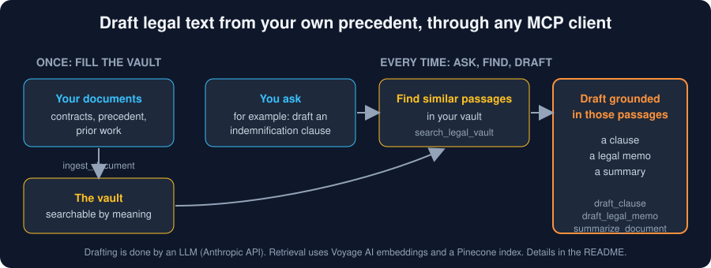

# lexibridge

**An MCP server that lets an LLM client search a vault of legal documents and draft clauses, memos and summaries, optionally grounded in the retrieved text.**

MCP (Model Context Protocol) is the standard that lets clients such as Claude Desktop call external tools. lexibridge exposes five tools. Once the server is deployed, a client only needs its URL.



## Tools

| Tool | What it does |
| --- | --- |
| `ingest_document(source_document, text)` | Splits `text` into chunks of about 800 characters, cutting only at sentence ends (English and Hindi sentence terminators are recognised), embeds each chunk and stores it in the vault. Returns the number of chunks stored. |
| `search_legal_vault(query, max_results=4)` | Embeds `query` and returns the `max_results` closest chunks as JSON: `source_document`, `page`, `text_content`, `relevance_score`. `page` is the chunk's position in the document, counted from 1. It is not a printed page number. |
| `draft_clause(instruction, clause_type, tone, reference_text, api_key, model)` | Drafts one contract clause. Defaults: `clause_type="general"`, `tone="formal"`. `reference_text` is optional precedent to ground the clause. |
| `draft_legal_memo(topic, key_facts, jurisdiction, legal_questions, research_context, api_key, model)` | Drafts a memo with the headings Question Presented, Brief Answer, Facts, Discussion, Conclusion. |
| `summarize_document(document_text, focus, api_key, model)` | Summarizes a document. Default `focus`: "key obligations, deadlines, and risks". |

**Typical flow:** call `ingest_document` to fill the vault, `search_legal_vault` to find precedent, then pass the returned text to a drafting tool as `reference_text` or `research_context`.

## Where your text goes

lexibridge runs as one cloud container. Text is **not** kept only on your machine:

| Step | What is sent | To |
| --- | --- | --- |
| `ingest_document` | every chunk of the document | Voyage AI (to embed), then Pinecone (stored with its vector) |
| `search_legal_vault` | the query | Voyage AI (to embed), then Pinecone (to find matches) |
| `draft_clause`, `draft_legal_memo`, `summarize_document` | all arguments of the call, including `reference_text`, `research_context` and `document_text` | Anthropic API |

`SPECIFICATION.md` describes a different design in which embedding runs on the user's machine and only vectors leave it. This deployment does not implement that design.

## Security notes

- **The server has no authentication of its own.** Anyone who knows the `/mcp` URL can call every tool, including reading and writing the vault.
- If the deployment sets `ANTHROPIC_API_KEY`, any caller who omits `api_key` uses that key and its quota. Leave it unset if every caller should supply their own.
- Treat the URL as a secret, or put the service behind your own access control.

## Quick start

### Deploy to Railway
1. In Railway choose **New Project, Deploy from GitHub repo** and select this repository. Railway detects the `Dockerfile`.
2. In the service **Variables** tab set:

   | Variable | Required | Default and purpose |
   | --- | --- | --- |
   | `PINECONE_API_KEY` | yes | Access to the vector store |
   | `VOYAGE_API_KEY` | yes | Access to the embedding API |
   | `PINECONE_INDEX` | no | `legal-vault-index` |
   | `VOYAGE_MODEL` | no | `voyage-law-2` |
   | `ANTHROPIC_API_KEY` | no | Server-wide fallback key for the drafting tools |
   | `ANTHROPIC_MODEL` | no | `claude-sonnet-5` |

3. Under **Settings, Networking** generate a domain. The MCP endpoint is `https://<your-app>.up.railway.app/mcp`.

The server creates the Pinecone index on first use (serverless, AWS `us-east-1`, cosine metric, 1024 dimensions). If an index with that name already exists with a different dimension, the call fails with an error that names both dimensions and says to delete the index so it can be recreated.

### Connect a client
Add this to the MCP client's configuration:

```json
{
  "mcpServers": {
    "lexibridge": {
      "url": "https://<your-app>.up.railway.app/mcp"
    }
  }
}
```

### Run locally with Docker
`server.py` serves HTTP only when the `PORT` environment variable is set. Without it, the server runs over stdio for a client that launches it directly.

```bash
cp .env.example .env   # set PINECONE_API_KEY and VOYAGE_API_KEY at minimum
docker build -t lexibridge .
docker run --env-file .env -e PORT=8000 -p 8000:8000 lexibridge
```

The endpoint is then `http://localhost:8000/mcp`.

### Bulk-ingest a local folder (optional)

```bash
python embed_offline.py --vault-dir ./legal_vault
```

This walks the folder recursively and ingests every `.txt` and `.md` file through the same path as `ingest_document`. The default folder is `./legal_vault`, set by `LEGAL_VAULT_DIR`.

## Bring your own Anthropic key

The three drafting tools take an optional `api_key` argument. Because one container serves many callers, the key travels with each call, so different callers' Anthropic accounts are never mixed. `model` is also optional.

```json
{ "instruction": "...", "api_key": "<your Anthropic API key>" }
```

If a call omits `api_key`, the server uses its `ANTHROPIC_API_KEY`. If neither exists, the tool returns an error saying so.

## Why embeddings use a hosted API

An earlier version loaded an ONNX embedding model inside the server process. That pulled in an ML stack large enough to run the Railway container out of memory on first use. Because text already goes to Pinecone, in-process embedding no longer kept text local, so embedding now goes through Voyage AI.

## Repository map

| File | Purpose |
| --- | --- |
| `server.py` | FastMCP server and the five tools |
| `vault.py` | Pinecone index creation, ingestion, search |
| `chunking.py` | Sentence-aware chunking (target 800 characters, minimum 200 before a split) |
| `embedding.py` | Voyage AI embedding calls |
| `llm.py` | Anthropic calls for the drafting tools |
| `config.py` | Environment variables and defaults |
| `embed_offline.py` | Optional bulk ingestion of a local folder |
| `Dockerfile`, `requirements.txt`, `.env.example` | Container and configuration |
| `SPECIFICATION.md` | An earlier, different design (local embedding), kept for reference |

## Disclaimer

Output is a drafting aid, not legal advice. A licensed attorney should review anything generated here before it is relied on or filed.
